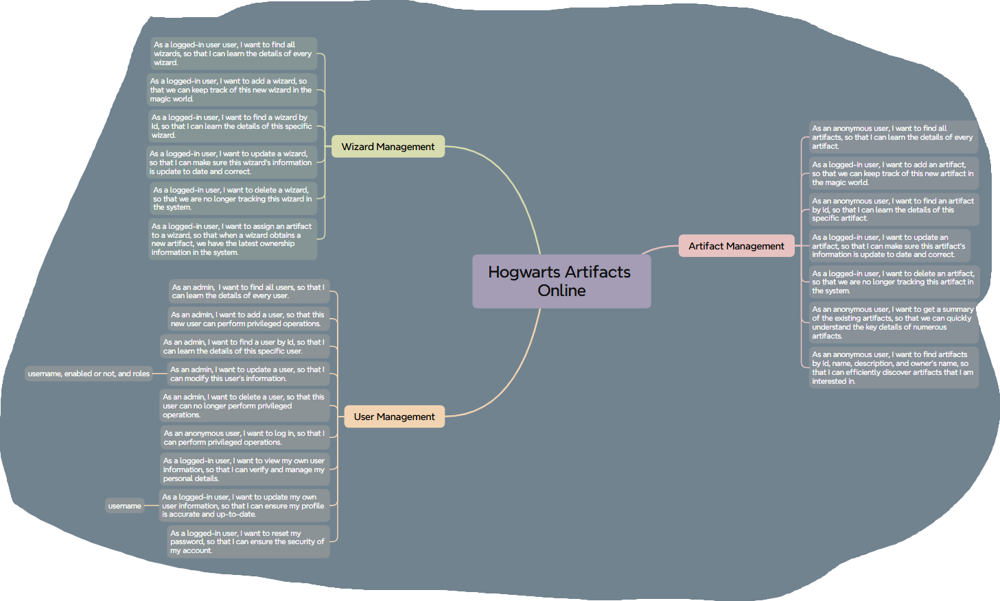

# Hogwarts Artifacts Online - Spring Boot Application

  

## What is 🧙‍♂️ Hogwarts Artifacts Online 🧙‍♀️?

Welcome to *Hogwarts Artifacts Online*, a sample back-end application designed to demonstrate typical use cases and best
practices in Spring Boot development. I wrote this sample application **line-by-line from scratch** following  a YouTube course
titled ["Learn Spring Boot 3 with Bingyang" ](https://youtube.com/playlist?list=PLqq9AhcMm2oPdXXFT3fzjaKLsVymvMXaY&si=QTkudVtqVpO1jPBA).

Throughout the course, *Hogwarts Artifacts Online* serves as a running example and is developed progressively. That is,
each episode introduces new Spring Boot features that add functionality or improvements to this project. This approach
helps see how different concepts fit together in a practical context.

In addition to exploring the features of Spring Boot, the course delves into essential software engineering practices.
It started by framing user stories, then moved on to crafting REST APIs and applied object-oriented design
principles. Embracing test-driven development, it meticulously taught me how to build and refine each feature. The culmination of
this journey is setting up a comprehensive CI/CD pipeline, ensuring smooth deployment of the application.


## What i  Learned?

Through the YouTube course, i gained practical experience in:

- **Dependency Injection** and the use of Spring Framework's core container.
- Building the web layer with **Spring MVC (Model-View-Controller)**.
- Data persistence in relational databases using **Spring Data JPA (Jakarta Persistence API)**.
- User authentication and authorization with **Spring Security** and **JWT (JSON Web Tokens)**.
- Deploying a Spring Boot application to a cloud platform with **Spring Cloud Azure**.
- Monitoring a running Spring Boot application in the production with **Spring Boot Actuator**.
- Making requests to OpenAI API with **RestClient**.
- Paging and sorting.
- Writing dynamic queries with Spring Data JPA Specifications.
- And more.

Additionally, the course emphasizes good software engineering practices, such as:

- Defining software requirements with **User Stories**.
- Version control and project planning using **Git and GitHub**.
- The **API-First Approach** in designing effective REST APIs.
- **Test-Driven Development (TDD)**: writing tests first, then coding to pass the tests, and refactoring.
- **Object-Oriented Design** with UML.
- **CI/CD (Continuous Integration and Continuous Delivery)** with GitHub Actions.

## Documentation

### Project User Stories




## Run Hogwarts Artifacts Online Locally

### Installation

1. **Clone the repository:**

   ```bash
   git clone https://github.com/jul1979/hogwarts-artifacts-online.git
   ```

2. **Navigate to the project directory:**

   ```bash
   cd hogwarts-artifacts-online
   ```

3. **Launch Redis**

   This Spring Boot application uses Redis for caching. You can run a Redis container using Docker:

   ```bash
   docker run -d -p 6379:6379 redis
   ```

4. **Run the application:**

   Since *Hogwarts Artifacts Online* is a Spring Boot application built using Maven, you can run it from Maven directly
   using the Spring Boot Maven plugin:

   ```bash
   ./mvnw spring-boot:run
   ```

   Or on Windows:

   ```bash
   .\mvnw.cmd spring-boot:run
   ```

## Building a Container

There is a `Dockerfile` in this project. You can build a container image (if you have a docker daemon):

```bash
./mvnw clean package -DskipTests # First, build the JAR file
docker build . # Second, build the container image
```

## Database Configuration

In its default configuration, *Hogwarts Artifacts Online* uses an in-memory database (H2) which
gets populated at startup with data. The H2 console is available at <http://localhost/h2-console>,
and it is possible to inspect the content of the database using the `jdbc:h2:mem:hogwarts` URL.

I have defined a
class [`edu.tcu.cs.hogwarts_artifacts_online.system.DBDataInitializer`]
to populate the H2 database at startup.


## Accessing the API Endpoints

Once the application is up and running locally, you are highly encouraged to test the REST API using your favorite API client, such as **Postman** or **Insomnia**. 
Happy testing! 🧪


## Acknowledgements

- Inspired by ["Learn Spring Boot 3 with Bingyang" ](https://youtube.com/playlist?list=PLqq9AhcMm2oPdXXFT3fzjaKLsVymvMXaY&si=QTkudVtqVpO1jPBA).


